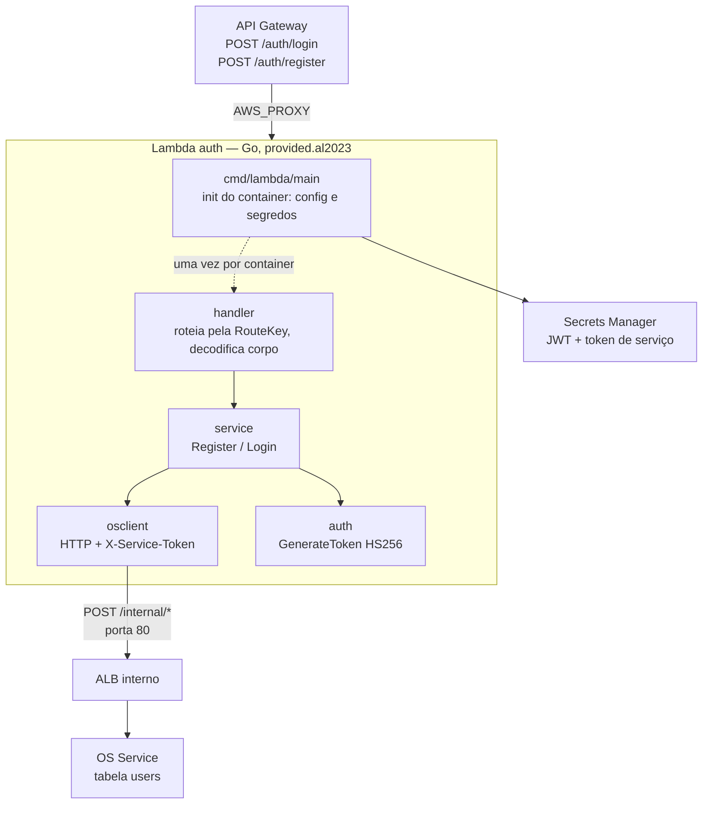
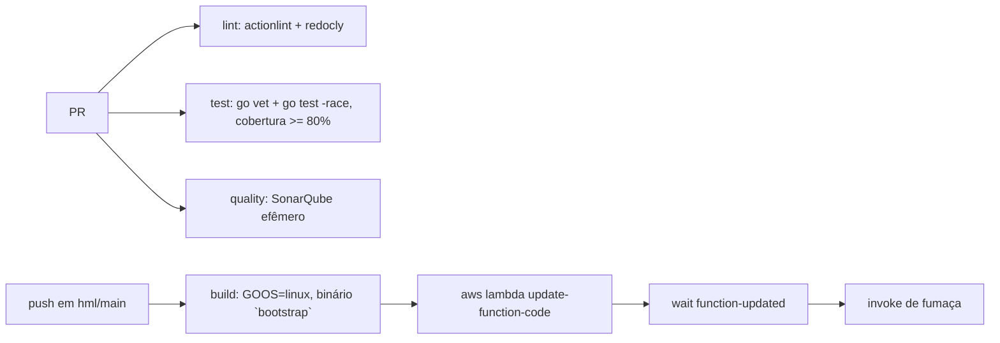

# oficina-mecanica-serverless

Função de autenticação da plataforma. Uma Lambda em Go que serve
`POST /auth/login` e `POST /auth/register` atrás do API Gateway, e emite o JWT
que o OS Service, o Billing e o Execution validam. A senha não é verificada
aqui: a função pergunta ao
[`oficina-mecanica-os-service`](https://github.com/SOAT-15-Oficina/oficina-mecanica-os-service),
dono da tabela `users`, e só emite o token.

> **Visão de arquitetura do sistema completo** vive em
> [`oficina-mecanica-infrastructure`](https://github.com/SOAT-15-Oficina/oficina-mecanica-infrastructure).
> Este README cobre apenas este repositório.

## Fronteiras

Na Fase 4 cada serviço tem banco próprio e ninguém lê o banco de outro
([RFC-0006, seção 8](https://github.com/SOAT-15-Oficina/oficina-mecanica-infrastructure/blob/main/docs/rfc/0006-microsservicos-e-saga.md)).
Por isso esta função **não tem banco e não abre conexão com nenhum**: ela chama
duas rotas internas do OS Service pelo ALB interno.

| Rota do painel | Chamada ao OS Service | Respostas do OS que importam |
|---|---|---|
| `POST /auth/login` | `POST /internal/credentials/verify` `{"username","password"}` | 200 `{"id","username","role"}` → emite o JWT; 401 → 401 |
| `POST /auth/register` | `POST /internal/users` `{"username","password","role"}` | 201 → 201; 409 → 409; 400 → 400 com a mesma mensagem |

As duas chamadas levam o header **`X-Service-Token`** e o `X-Request-Id` da
requisição do gateway. O token é um segredo próprio,
`oficina-mecanica/<ambiente>/internal-service-token`, criado pela camada
persistente da plataforma e lido pelos dois lados: esta função e o OS Service.
É distinto do segredo do JWT de propósito: vazar um não dá o outro.

| | |
|---|---|
| **Dono de `users` e do hash de senha (argon2id)** | `oficina-mecanica-os-service` |
| **CRUD administrativo `/users`** | OS Service |
| **Criação da função, VPC, IAM, API Gateway, segredo do token** | `oficina-mecanica-infrastructure` |
| **O que fica aqui** | rotas `/auth/*`, validação da entrada do cadastro e emissão do JWT |

Qualquer resposta inesperada do OS Service (5xx, timeout, corpo inválido) vira
**500**, nunca 401: credencial recusada e serviço fora do ar precisam continuar
distinguíveis.

## Contrato do token

Uma cópia de `AppClaims`/`GenerateToken`/`ParseToken` vive em `internal/auth/`
aqui **e** em cada serviço que valida o token. São ~40 linhas — não valem um módulo Go compartilhado
(que exigiria `GOPRIVATE` e deploy key nos dois CIs) nem um quinto repositório.

O que impede as cópias de divergirem é o fixture `internal/auth/testdata/token.golden`:
byte a byte o mesmo arquivo nos dois repositórios, com expiração fixa em 2099.
Cada repo tem um teste que o parseia. Renomear um claim ou trocar o algoritmo de
assinatura quebra o build dos dois, em vez de virar 401 em produção.

```bash
go run ./tools/gentoken > internal/auth/testdata/token.golden
cp internal/auth/testdata/token.golden \
   ../oficina-mecanica-os-service/internal/auth/testdata/token.golden
```

Regenere e copie **no mesmo PR**.

## Arquitetura deste repositório



Duas rotas numa única função: duas Lambdas dobrariam infraestrutura e cold
starts sem ganho. O `RouteKey` do evento decide qual caminho seguir.

Os segredos são lidos no **init do container**, não por invocação. O cliente
HTTP do OS Service tem timeout de 5s (`OS_INTERNAL_TIMEOUT`), bem abaixo dos 15s
da função.

**Fluxo de deploy deste repositório:**



## Contrato da API

| | |
|---|---|
| OpenAPI (fonte) | [`docs/openapi.yaml`](docs/openapi.yaml) |
| Rotas | `POST /auth/login`, `POST /auth/register` |
| Em um ambiente no ar | `<URL_PUBLICA>/api/auth/login` |

O contrato cobre **apenas** `/auth/*`. O resto da API tem contrato próprio no
`docs/swagger.yaml` de cada serviço.
Os dois são disjuntos por desenho: nenhum documenta rota do outro.

```bash
# exemplo
curl -X POST "$BASE/api/auth/login" \
  -H 'Content-Type: application/json' \
  -d '{"username":"admin","password":"..."}'
# → {"token":"eyJ..."}
```

## Deploy ativo

O ambiente é **efêmero**. A URL pública da API (CloudFront + `/api`) é estável
entre ciclos e fica no SSM:

```bash
aws ssm get-parameter --name /oficina-mecanica/prod/public_base_url \
  --query Parameter.Value --output text
```

| Ambiente | URL |
|---|---|
| Produção | `/oficina-mecanica/prod/public_base_url` |
| Homologação | `/oficina-mecanica/homolog/public_base_url` |

## Estrutura

```
cmd/lambda/          bootstrap: config, cliente do OS Service, handler, lambda.Start
internal/
  auth/              AppClaims + Generate/ParseToken + fixture de contrato
  config/            env + Secrets Manager (com fallback local)
  domain/            User e UserRole
  handler/           roteamento por RouteKey, tradução de erro → HTTP
  observability/     slog JSON e a taxonomia de campos da ADR-0011
  osclient/          cliente HTTP de /internal/credentials/verify e /internal/users
  service/           Register/Login e emissão do JWT
tools/gentoken/      gerador do fixture de contrato
docs/openapi.yaml    contrato — apenas /auth/*
```

## Observabilidade

Toda linha de log é JSON, com os mesmos nomes de campo dos serviços. Quem define
esses nomes é a [ADR-0011][adr11] no repositório de infraestrutura, e não este
repositório: eles são lidos literalmente pelas métricas de log e pelos alertas
do Datadog (`persistent/datadog_metrics.tf`, `persistent/datadog_monitors.tf`).
Renomear um campo aqui compila, passa nos testes e esvazia um painel em
silêncio — por isso os nomes vivem em constantes, em `internal/observability`, e
há teste sobre eles.

| Campo | De onde vem |
|---|---|
| `service` | `DD_SERVICE` (o Terraform injeta `auth-lambda`) |
| `env` | `DD_ENV` — sem ela, `local`, e o handler vira texto legível |
| `version` | SHA do commit, gravado no binário pelo linker no CI |
| `request_id` | `RequestContext.RequestID` do evento |
| `route`, `method`, `status`, `duration_ms` | linha de acesso, uma por invocação |
| `event` | evento de domínio — aqui, `auth.login_failed` |
| `integration` | dependência externa, em `level=ERROR` — aqui, `os-service` |
| `error` | `err.Error()` |

**`request_id` não é gerado: é herdado.** `RequestContext.RequestID` é o mesmo
valor que o API Gateway grava como `$context.requestId` no próprio access log.
É por isso que uma consulta por `@request_id` no Datadog devolve as duas
pontas — a linha da borda e a linha de dentro da função. O UUID gerado só
aparece em invocação direta, onde não há gateway.

**Nunca entram em log:** senha, o token emitido, o segredo do JWT e o token de
serviço. O
`username` de um login recusado entra — é o que torna a tentativa investigável.

[adr11]: https://github.com/SOAT-15-Oficina/oficina-mecanica-infrastructure/blob/main/docs/adr/0011-logs-estruturados-com-correlacao.md

## Rodando local

```bash
cp .env.example .env
docker compose up --build
```

Sobe a função no **Lambda Runtime Interface Emulator**. Ela precisa de um OS
Service respondendo em `OS_INTERNAL_BASE_URL` (padrão
`http://host.docker.internal:8081`, o compose do próprio OS Service) com o mesmo
`INTERNAL_SERVICE_TOKEN`. Sem `JWT_SECRET_ID`/`INTERNAL_SERVICE_TOKEN_SECRET_ID`
o config lê direto das variáveis e **não chama o Secrets Manager**.

| Variável | Local | AWS |
|---|---|---|
| `OS_INTERNAL_BASE_URL` | URL do OS Service | `http://<alb_dns_name>`, injetada pelo Terraform |
| `INTERNAL_SERVICE_TOKEN` / `INTERNAL_SERVICE_TOKEN_SECRET_ID` | valor | ARN do segredo |
| `JWT_SECRET_KEY` / `JWT_SECRET_ID` | valor | ARN do segredo |
| `OS_INTERNAL_TIMEOUT` | opcional, padrão `5s` | idem |

```bash
curl -s localhost:9000/2015-03-31/functions/function/invocations -d '{
  "routeKey": "POST /auth/register",
  "body": "{\"username\":\"admin\",\"password\":\"admin123\",\"role\":\"admin\"}"
}'
```

Para o fluxo completo (painel, Lambda e os três serviços atrás de um nginx que
replica o roteamento do CloudFront), use `local/docker-compose.local.yml` no
repositório de infraestrutura.

## Testes

```bash
go vet ./...
go test -race ./... -coverprofile=coverage.out
```

Nenhum teste precisa de banco ou de rede: o cliente do OS Service é testado
contra um `httptest.Server`. O CI barra cobertura abaixo de **80%** (sem `cmd/` e
`tools/`, a mesma exclusão do SonarQube).

## Qualidade

```bash
docker compose -f docker-compose.sonar.yml up -d sonarqube   # :9001
go test ./... -coverprofile=coverage.out
docker compose -f docker-compose.sonar.yml run --rm sonar-scanner
```

O CI sobe uma instância equivalente como service container efêmero e o Quality
Gate **bloqueia o merge**. Sem histórico entre execuções, o gate é avaliado sobre
o código todo, não sobre *new code*.

## Empacotamento e deploy

Produção é um **zip com um binário `bootstrap`** em `provided.al2023`, compilado
para **arm64** (Graviton). Sem container image: o binário tem poucos MB e o cold
start fica em ~50–150ms, mais o ENI da VPC na primeira invocação.

```bash
CGO_ENABLED=0 GOOS=linux GOARCH=arm64 go build -o dist/bootstrap ./cmd/lambda
(cd dist && zip -X function.zip bootstrap)
```

O CI faz isso e publica com `aws lambda update-function-code`, resolvendo o nome
da função no SSM:

| Parâmetro | Uso |
|---|---|
| `/oficina-mecanica/<ambiente>/auth_lambda_name` | alvo do `update-function-code` |

A função é **criada pelo Terraform** com um zip placeholder e
`lifecycle.ignore_changes` no código: o **artefato** é propriedade deste
pipeline; **VPC, memória, timeout, role e variáveis de ambiente** são
propriedade do repositório de infraestrutura.

### Dois ambientes

A **branch** escolhe o destino: `hml` publica em homologação, `main` em produção.
Não há input de ambiente em lugar nenhum deste repositório — o `ref` já carrega a
informação, e um input separado poderia contradizê-lo.

| | homologação | produção |
|---|---|---|
| Branch | `hml` | `main` |
| GitHub Environment | `homolog` | `production` |
| Prefixo no SSM | `/oficina-mecanica/homolog` | `/oficina-mecanica/prod` |

Por isso `AWS_DEPLOY_ROLE_ARN` é secret de **GitHub Environment**, não de
repositório: os dois ambientes usam o mesmo nome de secret e apenas o escopo do
Environment os separa. A trust policy da role repete a regra do lado da AWS — um
push em `hml` não obtém credencial de produção.

Arquitetura completa dos dois ambientes: `oficina-mecanica-infrastructure`.

### Secrets e variables necessários

| Nome | Tipo | Conteúdo |
|---|---|---|
| `AWS_DEPLOY_ROLE_ARN` | secret de **Environment** (`production` e `homolog`) | role assumida por OIDC (`lambda:UpdateFunctionCode` + SSM) |
| `AWS_REGION` | variable | `sa-east-1` |

## Rede e segredos em produção

A função roda **dentro da VPC, em subnets privadas**. O SG dela só sai para o
ALB interno na porta 80 (onde o OS Service atende `/internal/*`) e para HTTPS
(Secrets Manager, pelo NAT); o SG do ALB aceita a função na porta 80. Chave JWT
e token de serviço vêm do **Secrets Manager**, lidos uma vez por container (não
por invocação): em container reutilizado já estão em memória.

As rotas `/internal/*` não são publicadas no API Gateway como rotas próprias,
mas o `$default` do gateway leva ao mesmo ALB; quem as protege é o
`X-Service-Token`, comparado em tempo constante pelo OS Service.
